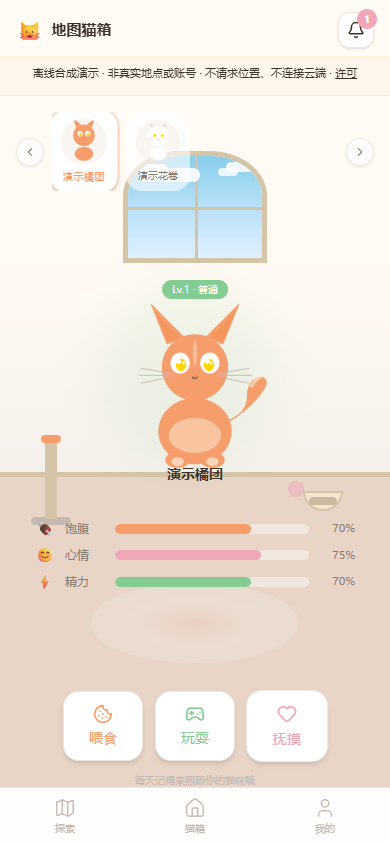

# MapCatBox App · 地图猫箱

温暖配色的猫咪地图与虚拟养成原型：在合成网格上探索猫咪，切换猫箱喂食/陪玩/抚摸，并编辑虚构用户资料。使用原有页面、猫咪SVG绘制和交互源码，公开预览增加独立的本机合成数据实现。

**开发中。默认是离线合成演示，所有人物、猫咪、故事和位置都是虚构样例；不是现实猫咪分布，也不是已上线的社交服务。** 源码保留个人Supabase云模式，但公开网页不启用它。

[在线合成演示](https://yangwei251003.github.io/mapcatbox-app/) · [云模式与未完成范围](docs/CLOUD_MODE.md) · [许可](THIRD_PARTY_NOTICES.md)



## 技术与功能范围

Next16.4.3 / React19.2.8 / TypeScript / Zustand / Tailwind4 / Framer Motion / Leaflet / React-Leaflet，Sharp0.35.5随锁文件保留，个人云源码采用 Supabase Auth、PostgreSQL、RLS与Realtime接口。`mapcatbox-local` 是另一个 React18/Vite 本地实现，二者独立归档。

- 公开离线版：8个合成标记、地图详情、猫箱2只虚拟猫咪、喂食/陪玩/抚摸状态、虚构资料编辑、通知已读、本浏览器持久化与重置。
- 公开版不收账号密码、不调用GPS、不写远程数据库、不加载在线瓦片/照片/字体；全局提示持续显示合成身份。数学网格不对应任何真实地点。
- 领养仍为原提示按钮；好友列表、设置、互动记录页面仍待实现。云端认证/RLS/RPC/Realtime、真实位置与服务端定时任务未连接验收，不把SQL/按钮等同已完成功能。

## 快速运行

安装 Node.js24、npm11，首次安装需要网络。默认运行无需账号、后端或地图服务。

```sh
git clone https://github.com/yangwei251003/mapcatbox-app.git
cd mapcatbox-app
npm ci
npm test
npm run build
npm run preview
```

打开 **http://127.0.0.1:4174**。开发使用 `npm run dev -- --hostname 127.0.0.1`；这里的静态导出不要使用 `next start`。子路径需要在构建前设置 `NEXT_PUBLIC_BASE_PATH=/mapcatbox-app`，预览时使用同样环境变量；工作流自动设置仓库前缀并强制云/定位开关false。

演示编辑的数据只保存在当前浏览器的新键 `mapcatbox_app_synthetic_v1`，清理站点数据或点击“重置合成演示”会删除修改。不要填真实联系方式、地址/GPS、私人账户或财产资料；原私人配置和旧数据不导入。

## 源码与运行边界

```text
src/app/                     首页、地图、猫箱、资料、认证入口
src/components/              原UI、动态地图、通知与底部导航
src/stores/                  Zustand业务状态；默认离线、显式云分支
src/lib/demo-state.ts         确定合成数据与本机持久化
src/lib/location-writer.ts    明确启用后的真实30秒写入节流
supabase/migrations/         架构/RPC/合成种子/隐私限制（未连库执行）
public/                      自有网格与猫图、完整运行依赖许可
tests/、verification/        有界位置节流验证与本次证据
```

源码、当前增量、必要自有SVG、锁文件和运行文档保留；依赖、机器缓存、旧Git历史、私人环境、真实地理种子和连接凭据不上传。原件仍须保存，不能把此安全公开快照当作私人数据或全量原资产备份。Pages只托管 `out` 静态前端；源码和云模式说明在仓库。

```sh
npm test
npm run typecheck
npm run lint
npm run licenses:generate
npm run build
```

具体通过项、依赖风险及未验证范围见[验证记录](docs/OPEN_SOURCE_VALIDATION.md)。位置写入器测试使用合成输入/假时钟/假写入器，不能证明真实GPS或云端数据库通过。

## 许可与计划

自有代码/文档/自有SVG采用[MIT](LICENSE)。React-Leaflet及core保留 **Hippocratic-2.1** 完整协议；其他依赖与原Next初始图标遵循各自许可，并非全栈纯MIT。生产包通知在 `licenses/` 和静态 `public/licenses/` 中；原外部瓦片/字体/图片不捆绑。

近期计划：在隔离后端完成跨用户RLS测试，补全好友/领养/设置与异常处理、服务端位置TTL/限流；保留当前合成模式用于公开体验。详见[更新记录](CHANGELOG.md)。
